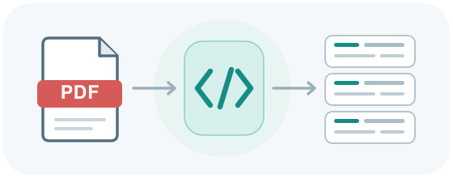

<div align="center">



# grobid-tei

[](https://pypi.org/project/grobid-tei/)

[](https://github.com/CoLRev-Environment/grobid-tei/blob/main/LICENSE)
[](https://github.com/CoLRev-Environment/grobid-tei/actions/workflows/tests.yml)

</div>

`grobid-tei` is a reusable Python client for an independently managed GROBID
service and a parser for its TEI XML output. It supports Python 3.10 and newer.
It does not start Docker or manage the GROBID service lifecycle.

## Installation

```bash
pip install grobid-tei
```

For a local checkout, install the package and its test tools with `uv`:

```bash
uv pip install .
uv sync --extra test
```

## Pre-commit checks

Install pre-commit and enable the repository hooks:

```bash
uv tool install pre-commit
pre-commit install
pre-commit run --all-files
```

The hooks check common file issues, format with Black, lint with Ruff, ensure
Python 3.10-compatible syntax, and run the test suite. The copied TEI XML
fixture is excluded from whitespace-fixing hooks so its source representation
is preserved.

## Start GROBID

`grobid-tei` requires a reachable GROBID service. You can use a local GROBID
installation or connect to a service hosted elsewhere; this package does not
start or manage the service.

### Convenient local option: Docker

If Docker is installed, start the GROBID 0.9.1 service and publish its API port:

```bash
docker run -d --name grobid -p 8070:8070 grobid/grobid:0.9.1-full
```

GROBID may take a little while to initialize. Check that it is ready; repeat the
check after a short wait if it does not return `true` yet:

```bash
curl http://localhost:8070/api/isalive
```

When running Python on the same host, use `http://localhost:8070` as the
`GrobidClient` service URL. The service must be reachable when constructing a
client because it discovers and caches the GROBID version by default. Pass
`skip_version=True` to defer that lookup. Stop the container when finished with
`docker stop grobid`.

## Convert a PDF to TEI

Once a GROBID service is available, configure its base URL explicitly:

```python
from pathlib import Path

from grobid_tei import GrobidClient, TEIDocument

client = GrobidClient(service_url="http://localhost:8070", timeout=180)
if not client.is_available():
    raise RuntimeError("GROBID is not available")

tei_xml = client.process_fulltext(Path("paper.pdf"))
Path("paper.tei.xml").write_bytes(tei_xml)

document = TEIDocument.from_bytes(tei_xml)
print(document.metadata())
print(document.metadata(abstract=True))
print(document.abstract())
print(document.references(include_citation_counts=True))
```

`process_fulltext` returns XML bytes. To enable GROBID consolidation explicitly,
pass `consolidate_header=True` and/or `consolidate_citations=True`.

## Parse a raw citation

`process_citation` parses one bibliographical reference and returns TEI XML
bytes, which can be read with `TEIDocument`:

```python
from grobid_tei import GrobidClient, TEIDocument

client = GrobidClient(service_url="http://localhost:8070")
citation_xml = client.process_citation(
    "Venkatesh, V., Morris, M. G., Davis, G. B., & Davis, F. D. (2003). "
    "User acceptance of information technology: Toward a unified view. "
    "MIS Quarterly, 27(3), 425–478. https://doi.org/10.2307/30036540",
    consolidate_citations=True,
)
citation_document = TEIDocument.from_bytes(citation_xml)
reference = citation_document.references()[0]
print(reference.fields)
# Example result (GROBID's extracted fields may vary):
# {
#     "author": "Venkatesh, V. and Morris, M. G. and Davis, G. B. and Davis, F. D.",
#     "title": "User acceptance of information technology: Toward a unified view",
#     "year": "2003",
#     "entrytype": "article",
#     "journal": "MIS Quarterly",
#     "volume": "27",
#     "number": "3",
#     "pages": "425--478",
#     "doi": "10.2307/30036540",
# }
```

## Parse multiple raw citations

Pass each reference separately to `process_citation_list`. It returns TEI XML
bytes containing the parsed references, which can be extracted with
`TEIDocument.references()`:

```python
from grobid_tei import GrobidClient, TEIDocument

client = GrobidClient(service_url="http://localhost:8070")
citations = [
    "Venkatesh, V., Morris, M. G., Davis, G. B., & Davis, F. D. (2003). "
    "User acceptance of information technology: Toward a unified view. "
    "MIS Quarterly, 27(3), 425–478. https://doi.org/10.2307/30036540",
    "Davis, F. D. (1989). Perceived usefulness, perceived ease of use, and "
    "user acceptance of information technology. MIS Quarterly, 13(3), "
    "319–340. https://doi.org/10.2307/249008",
]
citation_list_xml = client.process_citation_list(citations)
citation_list_document = TEIDocument.from_bytes(citation_list_xml)
for reference in citation_list_document.references():
    print(reference.fields)
```

Citation consolidation is disabled by default; pass
`consolidate_citations=True` to enable it for the list.

## Parse an existing TEI file

No running GROBID service is needed to parse an existing file:

```python
from pathlib import Path

from grobid_tei import TEIDocument

document = TEIDocument.from_file(Path("paper.tei.xml"))
print(document.grobid_version())
print(document.keywords())
print(document.author_details())

for paragraph in document.iter_paragraphs():
    print(paragraph)
```

## Public API

- `GrobidClient(service_url=..., timeout=180.0, skip_version=False)` discovers
  and caches the server version at initialization by default. Set
  `skip_version=True` to defer discovery until `version()` or
  `check_compatibility()` is called. The cache belongs to that client instance;
  create a new client to discover the version again. The client also provides
  `is_available()`, `version()`, optional `check_compatibility()`,
  `process_fulltext(...)`, `process_citation(...)`, and
  `process_citation_list(...)`.
- `check_compatibility()` rejects known-incompatible versions and warns, but
  proceeds, for versions not yet tested with this package. Compatibility
  checking is not run automatically during processing.
  `IncompatibleGrobidVersionError` identifies a known-incompatible server
  version.
- `TEIDocument.from_bytes(...)` and `TEIDocument.from_file(...)` create a parsed
  document. It provides `to_bytes()`, `grobid_version()`, `metadata()`,
  `abstract()`, `keywords()`, `author_details()`, `references()`,
  `citations_by_section()`, `iter_paragraphs()`, and
  `annotate_reference_ids(...)`.
- `TEIReference` is a mapping of generic lowercase bibliographic fields
  (`title`, `author`, `year`, `doi`, `journal`, and similar), with the GROBID
  identifier in `.tei_id` and an optional citation count in
  `.in_text_citation_count`. The identifiers and count are not included in its
  bibliographic field mapping.
- `GrobidServiceError` describes service request failures;
  `TEIParsingError` describes unsafe or invalid TEI XML. Both inherit from
  `GrobidTEIError`.

The parser uses `defusedxml` for safe XML parsing. `annotate_reference_ids()`
applies only a caller-supplied mapping from TEI IDs to caller IDs; it performs no
reference matching or workflow decisions.

## License

This project is licensed under the [MIT License](LICENSE).
